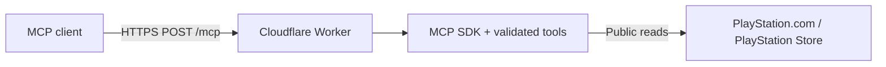

# PlayStation MCP

[简体中文](README.zh-CN.md) · [MIT license](LICENSE)

Find an official PlayStation game page, follow its edition links to the regional Store and see which monthly games Sony lists for PlayStation Plus.

## Connect

Paste the following address into a remote MCP client and select **Streamable HTTP**. The public tools work without an API key or platform sign-in.

```text
https://playstation-mcp.oratisoratisoratisoratis.workers.dev/mcp
```

**Codex**

```sh
codex mcp add playstation --url https://playstation-mcp.oratisoratisoratisoratis.workers.dev/mcp
```

**Claude Code**

```sh
claude mcp add --transport http --scope user playstation https://playstation-mcp.oratisoratisoratisoratis.workers.dev/mcp
```

Start a new conversation in Codex or open `/mcp` in Claude Code to check the connection.

## Can I connect my PSN account?

The hosted connector has **public access only**. Sony supports authorized third-party apps, and players can unlink them from Account Management. The `oratis` deployment has no Sony-approved application or granted PSN gameplay-data scopes. Adding this URL therefore opens the public tools without a Sony consent screen. [Sony's authorized apps guide](https://www.playstation.com/en-us/support/account/manage-authorized-apps/) · [PlayStation Partners](https://partners.playstation.net/)

| Personal data | Result in this release |
| --- | --- |
| Owned library and Plus entitlements | Unavailable. Store products and monthly promotions show what is offered in a region. |
| Earned trophies | Unavailable. This deployment has no authorized trophy data source. |
| Playtime per title | Unavailable. No account activity was retrieved. |

The public MCP smoke test exercises all four tools against Sony's US sources. No real PSN account grant or personal data was available for testing. Integration requires the application's approved redirect URI, scopes and authorized data endpoints from Sony, followed by a consenting player's test.

## Try it

> Find ASTRO BOT in the US, show the price and currency of its standard edition, then list this month's PlayStation Plus games with the official source.

Search for `astro bot`, open the `astro-bot` page, then pass its regional `product_id` to `store_offer`. A product ID identifies a particular edition. `monthly_games` reads the regional Plus page independently.

## Tools

| Tool | Inputs | Returns |
| --- | --- | --- |
| `search_games` | `query`, `region`, `limit` | Search regional editorial game-page slugs and return matching URLs |
| `game_details` | `slug`, `region` | Official title, description and linked Store product IDs |
| `store_offer` | `product_id`, `region` | Store title, edition category and available prices with currency |
| `monthly_games` | `region` | Publisher's period heading, monthly lineup and regional Plus page |

Regions are `en-us` (default) and `en-gb`. Search covers the English editorial game directory, a subset of the Store catalogue. Some game pages have no linked edition or published offer. The monthly lineup describes the publisher's regional promotion. Account eligibility, PSN trophies and owned games are outside the public data covered here.

## How requests work



The adapter reads game-page paths from Sony's public regional sitemap, extracts edition links from each game page and reads Product JSON-LD from the Store. The Plus adapter isolates the monthly games section of Sony's regional What's New page and returns the period heading alongside the titles.

Each request gets its own MCP server and transport. Inputs are validated before any upstream request. The Worker returns structured JSON and a text representation for clients that read text results. Platform failures are reported as tool errors. The service uses no account database or platform credentials. Search terms and lookup identifiers are sent to the relevant platform to complete the request.

[PlayStation games](https://www.playstation.com/en-us/games/) · [PlayStation Store](https://store.playstation.com/en-us/) · [PlayStation Plus monthly games](https://www.playstation.com/en-us/ps-plus/whats-new/)

## Run your own

Use Node.js 24 or later.

```sh
git clone https://github.com/oratis/playstation-mcp.git
cd playstation-mcp
npm ci
npm run check
npm test
npm run dev
```

In a second terminal, run the SDK smoke test. It negotiates the protocol, lists the tools and calls them against real platform data.

```sh
npm run smoke -- http://localhost:8787/mcp
```

`npm run smoke` without an argument checks the hosted service. `npm test` runs offline with fixture responses. To deploy, authenticate Wrangler with your Cloudflare account and run `npm run deploy`. Give clients the deployed Worker URL with `/mcp` appended.

## Connection checks

- A browser GET to `/mcp` returns HTTP 405. Open the [service information](https://playstation-mcp.oratisoratisoratisoratis.workers.dev/) to check the hostname, or use the smoke test for an end-to-end check.
- An upstream error after successful tool discovery concerns the platform lookup. Check the identifier and region, then retry.

Community project maintained by [oratis](https://github.com/oratis). Related connectors · [Steam MCP](https://github.com/oratis/steam-mcp) · [Nintendo MCP](https://github.com/oratis/nintendo-mcp).
